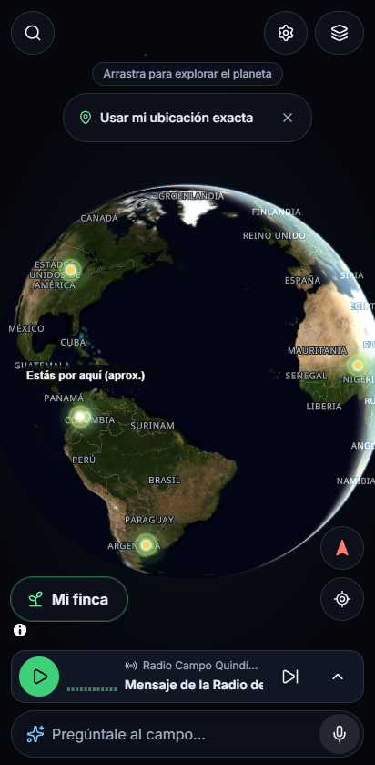
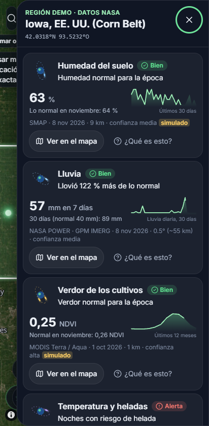
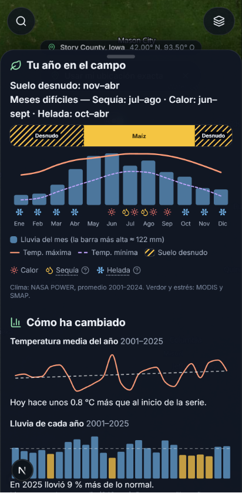
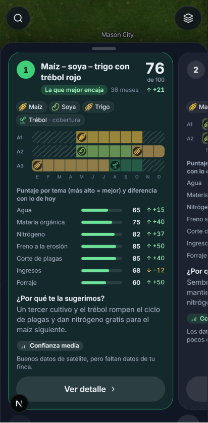
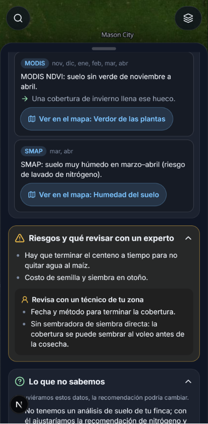
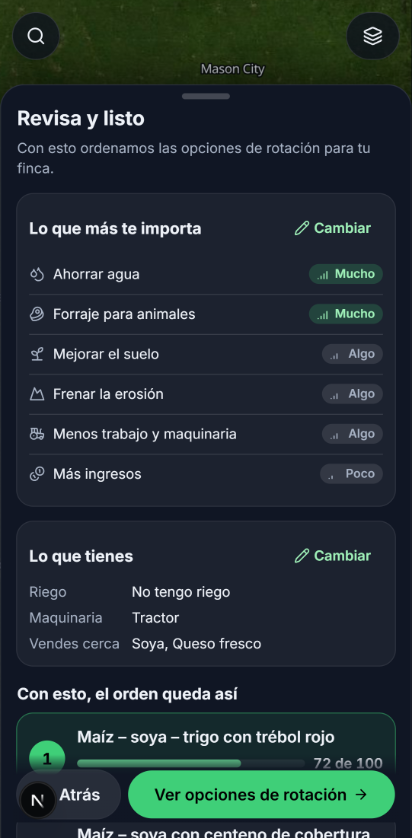
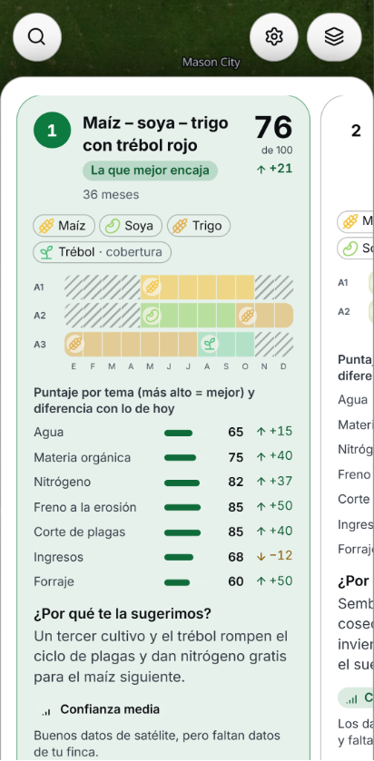
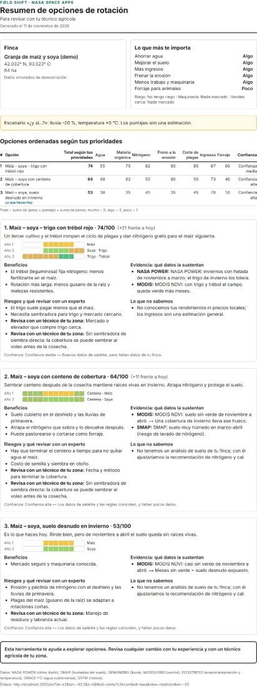
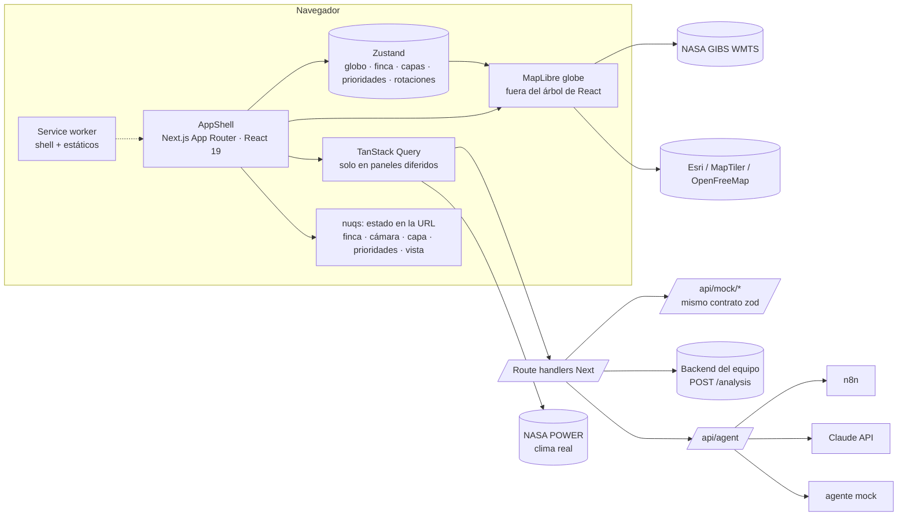

# Field Shift 🌎🌱

**NASA Space Apps 2026 · Reto _Field Shift: Adapting Farms with NASA Data_**

Field Shift es una app web (móvil primero) que ayuda a agricultores a **explorar rotaciones de cultivos** que mejoran
la salud del suelo y la resiliencia al clima, usando observaciones de la Tierra de la NASA. La persona busca su finca
en un globo 3D, ve cómo ha cambiado su clima, dice qué le importa (agua, suelo, ingresos…) y compara opciones de
rotación con su evidencia, riesgos y nivel de confianza.

> _English summary:_ a mobile-first decision-support web app. Find your farm on a 3D globe, see 25 years of NASA
> climate data for it, tell the app what matters to you, and compare crop rotations (including your current one)
> with evidence, risks and confidence. It supports, and never replaces, the farmer's judgment or local advisors.

<p>
  
  
  
  
</p>
<p>
  
  
  
  
</p>

## Qué hace

| | |
|---|---|
| **Globo 3D** | MapLibre con proyección de globo, vuela a tu zona al abrir (por IP; más preciso con permiso de GPS). |
| **Capas NASA** | SMAP (humedad del suelo), GPM/IMERG (lluvia), MODIS/VIIRS (verdor), ECOSTRESS, GRACE-FO, relieve SRTM, con leyenda, fecha y "¿qué es esto?". |
| **Drawer de región** | Toca una región: tarjetas de sensores con tendencia y explicación simple. |
| **Radio del campo** | Anuncios con voz IA por región (mock con audio real en `public/audio/`). |
| **Agente IA** | Pregúntale al campo: responde y mueve el globo (vuela, activa capas, abre el drawer). n8n → Claude → mock. |
| **Tu finca** | Busca, toca o dibuja tu parcela. Resumen, calendario anual (meses con suelo desnudo, estrés), tendencias de 25 años (NASA POWER real), riesgos del terreno y tu rotación actual. |
| **Prioridades** | Asistente de 3 pasos (mucho/algo/poco, riego, maquinaria, mercados). El orden se recalcula en el teléfono y la fórmula se muestra ("así calculamos el orden"). |
| **Rotaciones** | 3+ opciones incluida la actual: línea de tiempo, 7 puntajes con diferencia vs. hoy, evidencia NASA → regla agronómica (con "ver en el mapa"), riesgos, vacíos de información, comparar 2 mes a mes, "¿y si…?" (lluvia/temperatura), tabla lado a lado, compartir e imprimir. |
| **Tu plan (cultivos asociados)** | Cultivos que crecen bien juntos (tres hermanas, milpa con yuca, mijo con caupí, café con sombrío…) ordenados para tu finca con el clima de NASA POWER mes a mes, la altura y la raíz de cada planta (dibujo de perfil), cómo se ayudan o compiten, y una encuesta corta del terreno (qué siembras, qué sembraste la última vez, abono, rastrojo, plagas, para qué es la cosecha). Termina en una recomendación con confianza y vacíos, un plan de 2 años que asocia y rota, y "Arma tu mezcla" con sugerencias. |
| **Máquina del tiempo** | Elige un mes o un día pasado (desde 1981): las capas del mapa saltan a esa fecha, el drawer de región muestra ese mes y tu finca reconstruye lo que pasó día a día con NASA POWER (lluvias fuertes, rachas secas, calor, heladas). El agente entiende "¿cómo llovió en mayo?". Enlace compartible con `?t=2026-05`. |
| **Eventos y emergencias** | Deslizamientos, inundaciones, incendios, vendavales y más en el globo: NASA EONET (satélites, todo el mundo), el registro oficial de la **UNGRD** de Colombia (2019–2025, por municipio) y **reportes de la comunidad** marcados "sin verificar". Historial del municipio en el drawer de región, "Reportar un evento" sin datos personales (con el 123 primero) y el agente puede mostrarlos o abrir el formulario. Se combina con la máquina del tiempo: `?ev=1&t=2025-05`. |
| **Informe agroclimático** | Para una zona y un mes (o los últimos 30 días): lluvia y temperatura de cada día contra lo normal (NASA POWER), eventos del clima, emergencias cercanas (UNGRD, EONET y comunidad), qué vigilar y tabla diaria. Se imprime o guarda en PDF y se descarga en CSV (en español con `;` y coma decimal, como lo abre Excel). Desde el drawer de región ("Generar informe") o pidiéndoselo al agente ("genera un informe agroclimático de mayo"). Enlace: `/es/report?lat=…&lon=…&t=2025-05`. |
| **Para el campo** | Modo sol (alto contraste), unidades métricas o imperiales, español/inglés, glosario, PWA con último análisis sin conexión. |

**Modo demo:** abre `/?demo=1` para un recorrido guiado de ~70 s (ubicación → región → radio → agente → finca →
calendario → rotaciones → prioridades → tu plan con cultivos asociados → resumen imprimible).

## Cómo correrlo

Requisitos: Node 22+, pnpm 10.

```bash
pnpm install
cp .env.example .env.local     # los mocks funcionan sin llaves
pnpm dev                       # http://localhost:3000 (en el celular: pnpm dev --hostname 0.0.0.0)
```

| Variable | Dónde | Para qué |
|---|---|---|
| `NEXT_PUBLIC_USE_MOCKS` | cliente | `true` usa los mocks de `/api/mock/*` mientras el backend no está listo |
| `NEXT_PUBLIC_API_BASE_URL` | cliente | URL del backend real (contrato en `docs/api-contract.md`) |
| `NEXT_PUBLIC_MAPTILER_KEY` | cliente | opcional: imágenes satelitales de MapTiler (si no, Esri) |
| `N8N_WEBHOOK_URL`, `N8N_WEBHOOK_SECRET` | **solo servidor** | agente por n8n |
| `ANTHROPIC_API_KEY` | **solo servidor** | agente con Claude si no hay n8n |
| `AGENT_FORCE_MOCK` | solo servidor | `true` fuerza el agente mock (lo usan los e2e) |
| `DEFAULT_LAT`, `DEFAULT_LON` | solo servidor | ubicación por defecto si no hay IP |

```bash
pnpm lint && pnpm typecheck && pnpm test   # ESLint, TypeScript estricto, 168 pruebas unitarias
pnpm build && pnpm e2e                     # 25 pruebas e2e en Pixel 7 (incluye axe, modo demo, máquina del tiempo, eventos, informe y tu plan)
node scripts/bundle-size.mjs http://localhost:3100/es   # JS inicial (presupuesto < 150 KB gz)
node scripts/build-gibs-meta.mjs           # refresca fechas y leyendas de NASA GIBS antes de la demo
node scripts/build-admin-co.mjs            # regenera los límites de departamentos y municipios (DANE)
```

## Arquitectura del frontend



- **Rendimiento:** JS inicial ~149 KB gz (MapLibre, paneles, gráficas visx, Motion, terra-draw y vaul se cargan bajo
  demanda). El mapa nunca re-renderiza React por frame: se maneja imperativamente (`src/features/globe/camera.ts`).
  Detalles en [`docs/performance.md`](docs/performance.md).
- **Datos:** todas las respuestas se validan con zod ([`src/lib/api/contract.ts`](src/lib/api/contract.ts)). El clima
  de la finca viene de NASA POWER en vivo; el resto, del backend o de los mocks con el mismo contrato.
- **Ranking local:** puntaje = Σ(peso × puntaje) ÷ Σ pesos (mucho 5, algo 3, poco 1) — `src/features/priorities/ranking.ts`.
- **Escenarios "¿y si…?":** reglas simples documentadas en `src/features/rotations/whatIf.ts`, siempre marcadas como estimación.
- **Cultivos asociados:** rasgos típicos por cultivo (`traits.ts`), parejas conocidas y deducidas (`relations.ts`), ventana de siembra con
  NASA POWER (`climate.ts`) y puntaje en 5 temas (`planner.ts`) en `src/features/rotations/mixed/`; la fórmula se muestra en la app.

| Carpeta | Qué hay |
|---|---|
| `src/features/globe` | globo, cámara, intro, alternativa textual |
| `src/features/layers` | capas NASA GIBS, leyendas, comparación |
| `src/features/region`, `radio`, `agent` | drawer de región, radio del campo, chat con el agente |
| `src/features/events`, `src/server/events` | eventos y emergencias (EONET, UNGRD, comunidad) y reportes |
| `src/features/report` | informe agroclimático imprimible y CSV (`/[locale]/report`) |
| `src/features/field` | búsqueda/dibujo de la finca y panel de análisis |
| `src/features/priorities`, `rotations` | prioridades y comparación de rotaciones (+ `/print`) |
| `src/lib/api` | contrato zod, cliente, hooks, NASA POWER, modo sin conexión |
| `src/app/[locale]` | páginas: inicio, `/glossary`, `/about`, `/print`, 404 |

## Contratos

- API del backend: [`docs/api-contract.md`](docs/api-contract.md)
- Agente IA (acciones que mueven el globo): [`docs/agent-contract.md`](docs/agent-contract.md)
- Eventos y emergencias (fuentes, endpoints, reportes): [`docs/events.md`](docs/events.md)
- Radio: [`docs/radio.md`](docs/radio.md) · Idiomas: [`docs/i18n.md`](docs/i18n.md) · Usabilidad y accesibilidad: [`docs/usability.md`](docs/usability.md)

## Honestidad y límites

Cada recomendación muestra evidencia, confianza, vacíos de información y riesgos, con un recordatorio visible: la
herramienta **apoya, no reemplaza** el criterio del agricultor ni a los técnicos locales. Las fincas demo y las
estrategias de los mocks son ilustrativas; los píxeles de satélite promedian áreas grandes y llegan con retraso.
Los reportes de la comunidad no están verificados y la app no avisa a los organismos de emergencia (siempre se
muestra la línea 123).
Más en la página **Acerca de los datos** (`/about`).

## Créditos

Equipo Field Shift · NASA Space Apps 2026. Datos: NASA (SMAP, GPM IMERG, MODIS/VIIRS, HLS, ECOSTRESS, POWER,
GRACE-FO, SRTM, GIBS). Mapas: Esri/MapTiler, OpenFreeMap © colaboradores de OpenStreetMap, Terrarium (AWS Open Data).
Búsqueda: Nominatim/OpenStreetMap.

